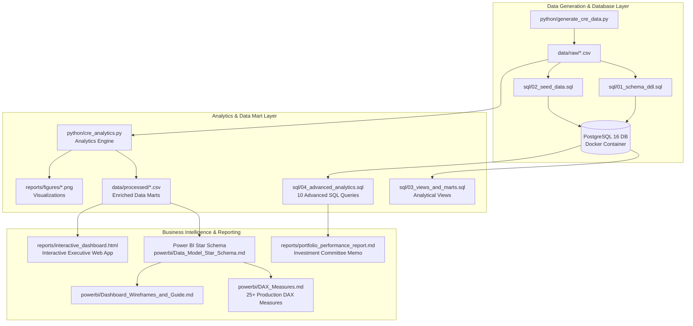
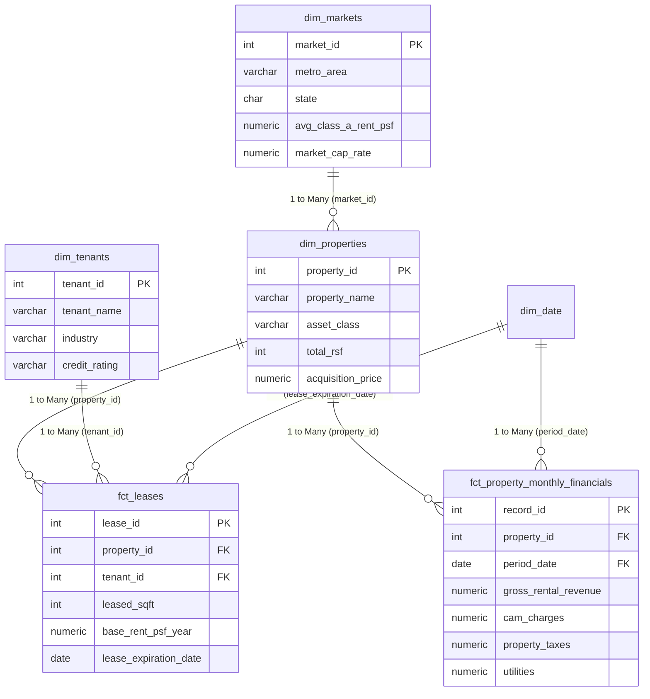

# Commercial Real Estate Portfolio Performance & Lease Risk Analytics

[](https://www.postgresql.org/)
[](https://www.python.org/)
[](https://powerbi.microsoft.com/)
[](https://www.docker.com/)
[](https://pandas.pydata.org/)

End-to-end commercial real estate portfolio analytics featuring financial performance, occupancy trends, lease rollover, tenant credit risk, and interactive scenario modeling.

---

## Resume Highlights & Project Summary

* **Relational Data Modeling (PostgreSQL 16):** Architected a Star Schema database integrating 25 properties, 99 corporate tenants, 159 active lease contracts, and 36 months (900 records) of property-level operating financials.
* **Advanced SQL Analytics:** Developed 10+ analytical queries leveraging Common Table Expressions (CTEs), multi-period Window Functions (`ROWS BETWEEN`, `LAG()`, `RANK()`), conditional aggregations, and rolling 12-month trailing metrics for Net Operating Income (NOI), Weighted Average Lease Term (WALT), Mark-to-Market rent variance, and tenant concentration.
* **Lease Rollover & Cash Flow Stress Testing:** Built scenario sensitivity models stress-testing $27.8M in 2026–2027 expiring lease revenues across 0% to 100% tenant retention scenarios to quantify downside cash flow vulnerability.
* **Power BI & DAX Architecture:** Authored a production DAX measure library (25+ measures) including time intelligence, WALT, occupancy rates, and credit risk distribution.
* **Python Pipeline & Automated Data Marts:** Automated end-to-end data validation, feature engineering, dimensional mart generation, and publication-quality figure generation using Pandas, NumPy, Matplotlib, and Seaborn.
* **Interactive Executive Dashboard:** Built a standalone responsive HTML5/Chart.js web dashboard with real-time slicers, property scorecards, and an interactive renewal stress-testing slider.

---

## Portfolio Snapshot (FY 2025)

```
========================================================================================
PORTFOLIO SUMMARY METRICS (25 ASSETS | 4 SUNBELT METROS)
========================================================================================
Total Rentable Area (RSF):      6,440,000 RSF
Occupied Leasable Area:         4,826,213 RSF (74.9% Occupancy)
FY2025 Gross Revenue:           $95,321,870 ($14.80 / RSF)
FY2025 Operating Expenses:      $52,681,804 ($8.18 / RSF)
FY2025 Net Operating Income:    $42,640,066 ($6.62 / RSF)
Portfolio NOI Margin:           44.7%
Portfolio WALT:                 3.56 Years
Tenant Concentration HHI:       195.2 (Unconcentrated / High Diversification)
Investment Grade Tenant Share:  61.4% of Total Contract Revenue
========================================================================================
```

---

## System Architecture



---

## Relational Star Schema Model



---

## Key SQL Queries Showcase

### 1. Rolling 12-Month (T12) NOI & Revenue with Window Frames
```sql
SELECT
    year_month,
    ROUND(monthly_revenue, 2) AS monthly_revenue,
    ROUND(monthly_noi, 2) AS monthly_noi,
    ROUND(SUM(monthly_revenue) OVER (
        ORDER BY period_date 
        ROWS BETWEEN 11 PRECEDING AND CURRENT ROW
    ), 2) AS t12m_cumulative_revenue,
    ROUND(SUM(monthly_noi) OVER (
        ORDER BY period_date 
        ROWS BETWEEN 11 PRECEDING AND CURRENT ROW
    ), 2) AS t12m_cumulative_noi,
    ROUND(
        (SUM(monthly_noi) OVER (ORDER BY period_date ROWS BETWEEN 11 PRECEDING AND CURRENT ROW) /
         NULLIF(SUM(monthly_revenue) OVER (ORDER BY period_date ROWS BETWEEN 11 PRECEDING AND CURRENT ROW), 0)) * 100, 2
    ) AS t12m_rolling_noi_margin_pct
FROM monthly_totals
ORDER BY period_date ASC;
```

### 2. Weighted Average Lease Term (WALT) Calculation
```sql
SELECT
    property_name,
    asset_class,
    metro_area,
    total_rsf,
    SUM(leased_sqft) AS occupied_rsf,
    ROUND((SUM(leased_sqft)::NUMERIC / total_rsf) * 100, 2) AS occupancy_pct,
    -- Square-Footage Weighted WALT
    ROUND(
        (SUM(leased_sqft * remaining_years) / NULLIF(SUM(leased_sqft), 0))::NUMERIC, 2
    ) AS sqft_walt_years,
    -- Revenue-Weighted WALT
    ROUND(
        (SUM(annual_rent * remaining_years) / NULLIF(SUM(annual_rent), 0))::NUMERIC, 2
    ) AS rent_walt_years
FROM lease_term_calc
GROUP BY property_id, property_name, asset_class, metro_area, total_rsf
ORDER BY sqft_walt_years ASC;
```


## How to Run & Explore

### 1. Run PostgreSQL Database with Docker
```bash
# Start PostgreSQL container
docker compose up -d

# Connect via psql
docker exec -it cre_portfolio_db psql -U cre_admin -d cre_portfolio

# Execute DDL, seed data, and analytical views
\i /sql/01_schema_ddl.sql
\i /sql/02_seed_data.sql
\i /sql/03_views_and_marts.sql
\i /sql/04_advanced_analytics.sql
```

### 2. Execute Python Analytics Pipeline
```bash
# Install dependencies
pip install -r requirements.txt

# Run analytics pipeline (validates data, exports marts, generates figures)
python python/cre_analytics.py
```

### 3. Open Interactive Executive Dashboard
Open `portfolio_intelligence-dashboard.html` in any modern web browser (Chrome, Edge, Safari, or Firefox) to explore the interactive dashboard, filter portfolio metrics, analyze financial performance, and simulate lease renewal scenarios.
