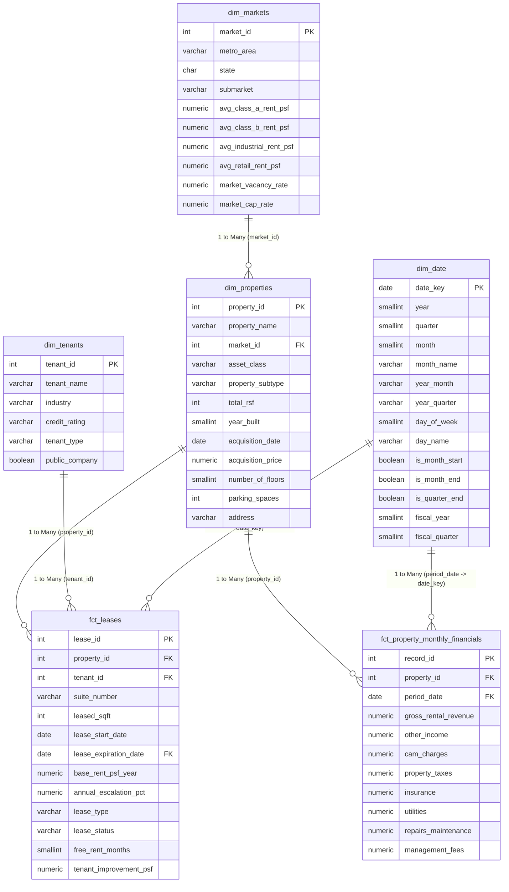

# Commercial Real Estate Portfolio Analytics — Star Schema Data Model

This document outlines the Star Schema relational data model designed in PostgreSQL and optimized for Power BI / Analysis Services.

---

## 1. Star Schema Architecture Diagram

---

## 2. Table Granularity & Schema Specification

### Dimension Tables

| Dimension | Primary Key | Granularity | Business Purpose |
| :--- | :--- | :--- | :--- |
| **`dim_markets`** | `market_id` | 1 row per Sunbelt Metro Submarket | Market asking rents, baseline cap rates & market vacancy benchmarks |
| **`dim_properties`** | `property_id` | 1 row per physical commercial property | Property master data: Asset class, RSF, Acquisition price, physical attributes |
| **`dim_tenants`** | `tenant_id` | 1 row per corporate tenant | Credit rating, industry classification, tenant scale (National/Regional/Local) |
| **`dim_date`** | `date_key` | 1 row per calendar day (2020–2030) | Master calendar for DAX time intelligence, fiscal calendar, reporting periods |

### Fact Tables

| Fact Table | Primary Key | Foreign Keys | Granularity | Business Purpose |
| :--- | :--- | :--- | :--- | :--- |
| **`fct_leases`** | `lease_id` | `property_id`, `tenant_id`, `lease_expiration_date` | 1 row per executed lease contract | Contractual base rent PSF, escalation, leased square footage, expiration dates |
| **`fct_property_monthly_financials`** | `record_id` | `property_id`, `period_date` | 1 row per property per month (36 months) | Actual gross revenue, OPEX breakdown (CAM, taxes, insurance, utilities, maintenance, management) |

---

## 3. Power BI Relationship Configuration

1. **`dim_properties` (1) ➔ `fct_leases` (\*)**:
   - Cardinality: One-to-Many (`1:*`)
   - Cross-filter direction: Single (`dim_properties` filters `fct_leases`)
   - Relationship Key: `property_id`

2. **`dim_tenants` (1) ➔ `fct_leases` (\*)**:
   - Cardinality: One-to-Many (`1:*`)
   - Cross-filter direction: Single (`dim_tenants` filters `fct_leases`)
   - Relationship Key: `tenant_id`

3. **`dim_properties` (1) ➔ `fct_property_monthly_financials` (\*)**:
   - Cardinality: One-to-Many (`1:*`)
   - Cross-filter direction: Single (`dim_properties` filters `fct_property_monthly_financials`)
   - Relationship Key: `property_id`

4. **`dim_date` (1) ➔ `fct_property_monthly_financials` (\*)**:
   - Cardinality: One-to-Many (`1:*`)
   - Cross-filter direction: Single (`dim_date` filters `fct_property_monthly_financials`)
   - Relationship Key: `dim_date[date_key] = fct_property_monthly_financials[period_date]` (Active)

5. **`dim_date` (1) ➔ `fct_leases` (\*)**:
   - Cardinality: One-to-Many (`1:*`)
   - Cross-filter direction: Single
   - Relationship Key: `dim_date[date_key] = fct_leases[lease_expiration_date]` (Active for Rollover Schedule)
   - Secondary Inactive Relationship: `dim_date[date_key] = fct_leases[lease_start_date]` (Activated via `USERELATIONSHIP` in DAX)

6. **`dim_markets` (1) ➔ `dim_properties` (\*)**:
   - Cardinality: One-to-Many (`1:*`)
   - Cross-filter direction: Single (`dim_markets` filters `dim_properties`)
   - Relationship Key: `market_id`
